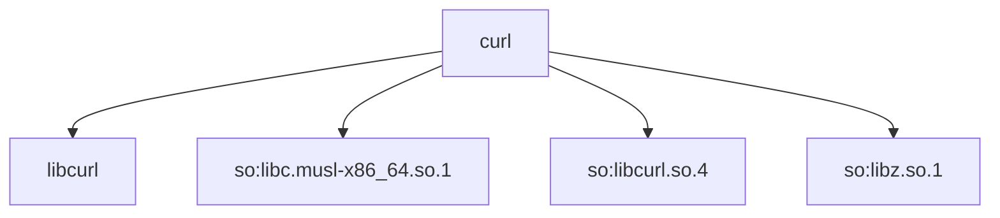

# Визуализатор графа зависимостей (Вариант №3)

## 1. Общее описание

CLI-инструмент для анализа, построения и визуализации графа зависимостей пакетов менеджера Alpine Linux (`apk`) без использования готовых пакетных менеджеров и сторонних библиотек для получения зависимостей.

Программа поддерживает:
* загрузку и парсинг индекса пакетов `APKINDEX.tar.gz` по HTTP/HTTPS;
* работу с локальными тестовыми графами зависимостей;
* построение транзитивного графа зависимостей нерекурсивным алгоритмом BFS;
* фильтрацию пакетов по заданной подстроке и корректную обработку циклических зависимостей;
* вычисление порядка загрузки (установки) зависимостей;
* генерацию текстового описания графа на языке диаграмм **Mermaid**.

## 2. Описание всех функций и настроек

### Параметры командной строки (CLI)
* `-p`, `--package` — имя анализируемого пакета (обязательный параметр).
* `-r`, `--repo` — URL-адрес репозитория Alpine Linux или путь к файлу тестового репозитория (обязательный параметр).
* `-t`, `--test-mode` — флаг включения режима работы с тестовым репозиторием.
* `-v`, `--version` — версия анализируемого пакета (обязательный параметр).
* `-f`, `--filter` — подстрока для фильтрации пакетов (пакеты, содержащие подстроку, исключаются из анализа; по умолчанию пустая).
* `-l`, `--load-order` — режим вывода порядка загрузки зависимостей вместо диаграммы Mermaid.

### Структура модулей (`src/`)
* `src/config.py` — парсинг аргументов CLI (`create_parser`, `parse_arguments`) и валидация параметров (`validate_config`, `AppConfig`).
* `src/apk_provider.py` — загрузка архива `APKINDEX.tar.gz` (`load_real_repo_map`), разбор записей пакетов и очистка версионных ограничений (`build_apk_index_map`), а также чтение тестовых графов (`load_test_repo_map`).
* `src/graph_builder.py` — построение транзитивного графа зависимостей алгоритмом BFS без рекурсии (`build_dependency_graph_bfs`) и расчет порядка загрузки пакетов (`compute_load_order`).
* `src/mermaid_visualizer.py` — формирование текстового представления графа зависимостей на языке диаграмм Mermaid (`generate_mermaid_diagram`).
* `src/main.py` — точка входа CLI-приложения, координация режимов работы и вывод результатов/ошибок.

## 3. Описание команд для сборки проекта и запуска тестов

Проект написан на стандартной библиотеке Python 3 и не требует установки внешних зависимостей или предварительной компиляции.

### Запуск приложения (Windows)
Запуск с демонстрационными параметрами:
```cmd
run.bat
```

### Запуск модульных тестов
```cmd
py -m unittest discover -s tests -v
```

### Демонстрационные сценарии в папке `tests/`
* Этап 3 (обход BFS, циклы, фильтрация): `tests\test_stage3_simple.bat`, `tests\test_stage3_cycle.bat`, `tests\test_stage3_filter.bat`, `tests\test_stage3_real.bat`.
* Этап 4 (порядок загрузки): `tests\test_stage4_simple.bat`, `tests\test_stage4_diamond.bat`, `tests\test_stage4_cycle.bat`, `tests\test_stage4_real.bat`.
* Этап 5 (визуализация Mermaid для трех пакетов): `tests\test_stage5_pkg1_curl.bat`, `tests\test_stage5_pkg2_git.bat`, `tests\test_stage5_pkg3_bash.bat`, `tests\test_stage5_test_graph.bat`.

## 4. Примеры использования

### Пример 1. Визуализация зависимостей пакета `curl` (Mermaid)
```cmd
py src/main.py -p curl -r https://dl-cdn.alpinelinux.org/alpine/v3.20/main -v 8
```
Результат на языке Mermaid:


### Пример 2. Визуализация зависимостей пакета `git` (Mermaid)
```cmd
py src/main.py -p git -r https://dl-cdn.alpinelinux.org/alpine/v3.20/main -v 2
```

### Пример 3. Визуализация зависимостей пакета `bash` (Mermaid)
```cmd
py src/main.py -p bash -r https://dl-cdn.alpinelinux.org/alpine/v3.20/main -v 5
```

### Пример 4. Визуализация тестового графа с фильтрацией
```cmd
py src/main.py -p A -r test_repos/graph_filter.txt -t -v 1.0.0 -f TEST
```
Результат:


### Сравнение со штатными инструментами визуализации `apk` и объяснение расхождений

В штатном пакетном менеджере Alpine Linux для получения графа зависимостей используется команда `apk dot <пакет>` (генерирует граф в формате Graphviz DOT) или дерево `apk info -R <пакет>`. При сравнении результатов нашей программы с выводом штатных инструментов `apk` возникают следующие закономерные расхождения:
1. **Формат представления**: разработанный инструмент генерирует диаграмму на языке **Mermaid** (`graph TD`), тогда как штатная утилита `apk dot` формирует описание на языке **Graphviz DOT**.
2. **Виртуальные зависимости (`so:...`, `/bin/sh`, `cmd:...`)**: в `APKINDEX` зависимости записываются в поле `D:` в виде предоставляемых сущностей (разделяемых библиотек `so:libz.so.1` или команд `/bin/sh`). Штатный `apk dot` разрешает их через индекс `provides` (`p:`) в конкретные имена реальных пакетов (`zlib`, `busybox`), а наш парсер отображает их как самостоятельные узлы графа, так как по условию запрещено использовать пакетный менеджер.
3. **Учет локального состояния и альтернатив**: штатный `apk` при построении графа учитывает архитектуру, установленные в системе пакеты и приоритеты провайдеров при наличии нескольких пакетов, предоставляющих одну зависимость. Наш инструмент выполняет чистый транзитивный обход (BFS) по метаданным удаленного индекса `APKINDEX`.
